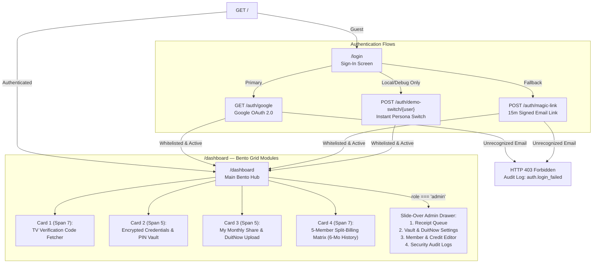
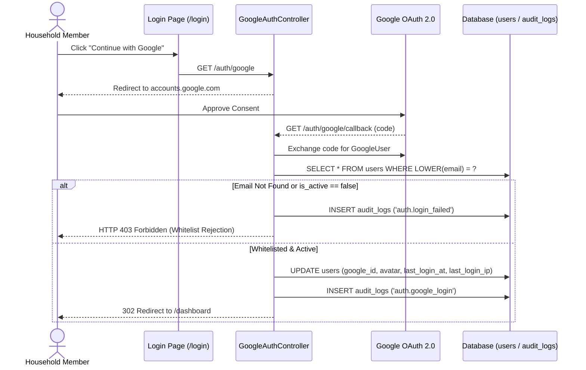
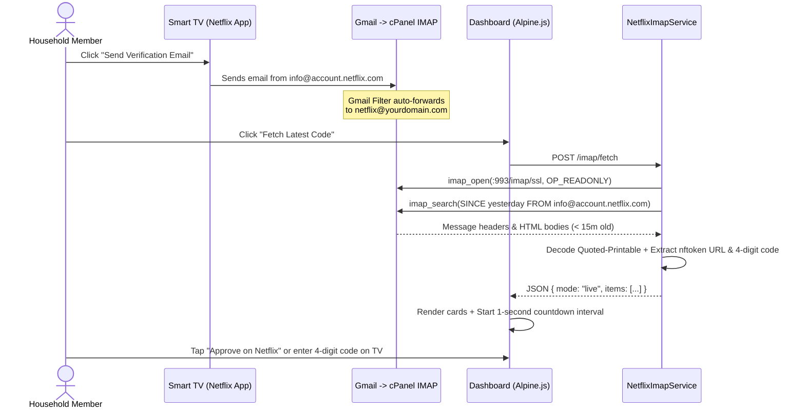
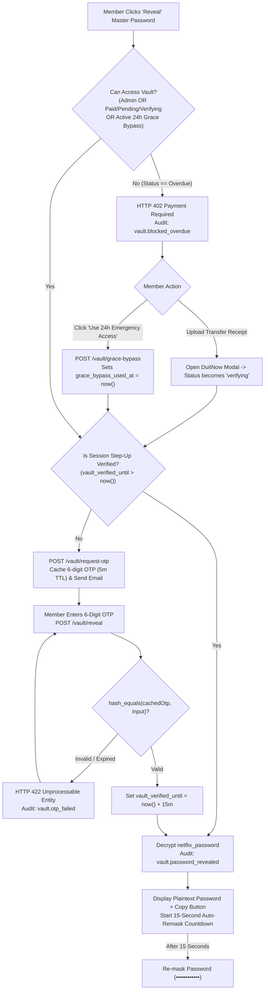
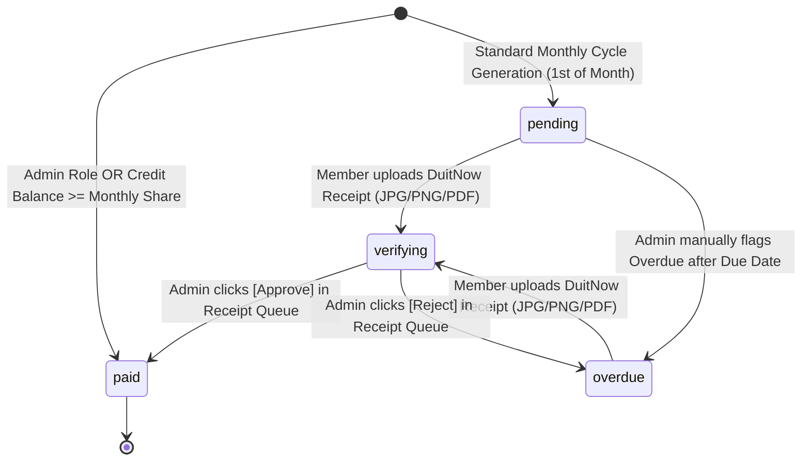

# 3. App Flow Documentation (AFD)
**Project Name:** Netflix Household & Split-Billing Portal ("Netflix Household Hub")  
**Document Version:** 1.0

---

## 1. High-Level Information Architecture & Sitemap

Because the application is purpose-built for speed and simplicity (especially when a member is standing in front of a Smart TV with a 15-minute verification timer), all member and admin workflows live within a unified **Single-Page Bento Dashboard** once authenticated.

---

## 2. Flow 1: Authentication & Strict 5-Member Whitelist Gate

### 2.1 User Journey Steps
1. User navigates to `/` and is redirected to `/login` ([`resources/views/auth/login.blade.php`](file:///c:/laragon/www/netflix-automation/resources/views/auth/login.blade.php)).
2. User chooses one of the available sign-in methods:
   * **Option A (Google OAuth):** Clicks **"Continue with Google"**. Google redirects back to `/auth/google/callback`.
   * **Option B (Passwordless Magic Link):** Enters their email address and clicks **"Send Sign-In Link"**. Clicks the 15-minute signed link received in their email (`/auth/magic-link/verify/{user}?expires=...&signature=...`).
   * **Option C (Local Demo Switcher):** In local/debug mode, clicks any of the 5 household member cards to switch personas immediately.
3. Backend verifies `LOWER(email)` exists in `users` and `is_active === true`.
4. On success, updates `last_login_at` and `last_login_ip`, regenerates the session ID, writes an `audit_logs` entry, and redirects to `/dashboard`.

---

## 3. Flow 2: On-Demand TV Household Verification Code Fetcher

### 3.1 User Journey Steps
1. Member opens Netflix on their Smart TV and encounters the *"This TV isn't part of your Netflix Household"* or *"Temporary Access Code"* screen.
2. Member selects **"Send Email"** on their TV remote.
3. Netflix sends the verification email to the Admin's Gmail, which automatically forwards it to `netflix@yourdomain.com`.
4. Member opens the Household Hub on their phone/laptop and clicks **"Fetch Latest Code"** in **Card 1**.
5. Alpine.js dispatches an asynchronous `POST /imap/fetch` request and shows a loading spinner.
6. [`NetflixImapService::fetchRecentCodes()`](file:///c:/laragon/www/netflix-automation/app/Services/NetflixImapService.php#L15-L86) connects to the IMAP inbox over SSL, parses messages from the last 15 minutes, and returns structured JSON items.
7. Card 1 renders each verification request with:
   * Requesting **Profile Name** & **Device Type**
   * Live ticking **MM:SS countdown timer** (`remaining_seconds` decrementing every second in Alpine.js)
   * Copyable **4-Digit Code** badge (if present)
   * Direct **"Approve on Netflix ↗"** button linking to the extracted `nftoken` URL.

---

## 4. Flow 3: Encrypted Master Vault, Payment Gate & Step-Up OTP

### 4.1 User Journey Steps
1. In **Card 2 (Account Credentials)**, the member always sees:
   * Master Netflix Email + `[Copy]` button
   * Their personal **Netflix Profile Name** and decrypted **4-Digit Profile Lock PIN**
   * Masked Master Password (`••••••••••••`)
2. When the member clicks **[Reveal]**:
   * **Case A: Current Month Payment is `overdue` (and no active Grace Bypass):**
     * Backend returns `HTTP 402 Payment Required`.
     * UI displays the Overdue Lock Callout with two actions: **"Pay Now"** (opens DuitNow payment modal) or **"Use 24h Emergency Access"** (`POST /vault/grace-bypass`).
   * **Case B: Member is Eligible & Already Step-Up Verified (`session('vault_verified_until') > now()`):**
     * Backend immediately returns the decrypted password (`POST /vault/reveal`).
   * **Case C: Member is Eligible & Needs Step-Up OTP:**
     * UI calls `POST /vault/request-otp`.
     * Backend caches a 6-digit OTP for 5 minutes and emails it to the member (also showing a yellow `demoOtpHint` banner in local/debug mode).
     * Member enters the 6-digit OTP in the inline input and clicks **[Unlock]**.
     * Backend verifies the OTP via `POST /vault/reveal`, marks the session verified for 15 minutes, logs `vault.password_revealed`, and returns the plaintext password.
3. Once revealed, Alpine.js starts a **15-second client-side auto-remask timer** (`revealRemaining`), automatically hiding the password back to `••••••••••••` when the timer hits `0`.

---

## 5. Flow 4: Split-Billing & DuitNow Receipt Verification Lifecycle

### 5.1 Payment Status State Machine
Every member's monthly payment record (`payments` table) transitions through four well-defined states:

### 5.2 Step-by-Step Receipt Upload & Approval Flow
1. **Cycle Initialization:** On the 1st of the month, `billing:generate-cycle` creates the cycle (`YYYY-MM`). Members with sufficient `credit_balance` are auto-marked `paid`; others start as `pending`.
2. **Viewing DuitNow Details:** Member opens **Card 3 (My Monthly Payment)** and clicks **"Pay / Upload Receipt"**. The modal displays the Admin's DuitNow QR code, Bank Name (*Maybank*), Account Holder, and a `[Copy]` button for the account number.
3. **Uploading Transfer Receipt:** Member selects their bank transfer screenshot/PDF (`<= 4 MB`), enters an optional reference note (e.g., `Maybank2u Ref #M2U884120`), and submits `POST /payments/{payment}/upload-receipt`.
4. **Pending Verification State:**
   * File is saved to `storage/app/private/receipts/`.
   * `payment.status` changes to `verifying` and `paid_at` is set to `now()`.
   * Notice email is dispatched to all active Admins.
   * Note: Putting a payment into `verifying` immediately restores vault eligibility if the member was previously `overdue`.
5. **Admin Verification:**
   * Admin sees the amber badge count on the **Admin** button in the top navbar and opens the slide-over Admin Drawer.
   * Admin clicks **"View Receipt ↗"** (`/payments/{payment}/receipt`) to inspect the image/PDF in a new tab.
   * Admin clicks **[Approve]** (`decision=approve` -> sets `status = 'paid'`, `verified_at = now()`, `verified_by = admin.id`) or **[Reject]** (`decision=reject` -> sets `status = 'overdue'`, clearing verification fields).

---

## 6. Flow 5: Edge Cases & Error Recovery Flows

| Scenario | System Behavior & Recovery Path |
| :--- | :--- |
| **IMAP Server Unreachable or Invalid Credentials** | `@imap_open` suppresses PHP warnings, logs `imap.connection_failed` in `audit_logs` with `imap_last_error()`, and returns `{ mode: "error", error: "..." }` so the UI renders a clean rose alert banner instead of a 500 crash. |
| **Local Environment Without `ext-imap` or `.env` IMAP Host** | `NetflixImapService` detects unconfigured host or missing `imap_open` and automatically switches to `{ mode: "demo" }`, returning 2 realistic live-parsed verification requests with active countdown timers. |
| **Overdue Member Needs Urgent TV Sign-In at Midnight** | Member clicks **"Use 24h Emergency Access"** in Card 2. If `grace_bypass_used_at` is `null` or older than 30 days, the system grants immediate 24-hour vault eligibility and logs `vault.grace_bypass_activated`. |
| **Member Pays 3 Months in Advance (e.g., RM 33.00)** | Admin adds `RM 22.00` to the member's `credit_balance` in the Admin Drawer -> **Members** tab. For the next 2 monthly cycles, `billing:generate-cycle` automatically deducts `RM 11.00/month` and marks their share `paid` without requiring receipt uploads. |

