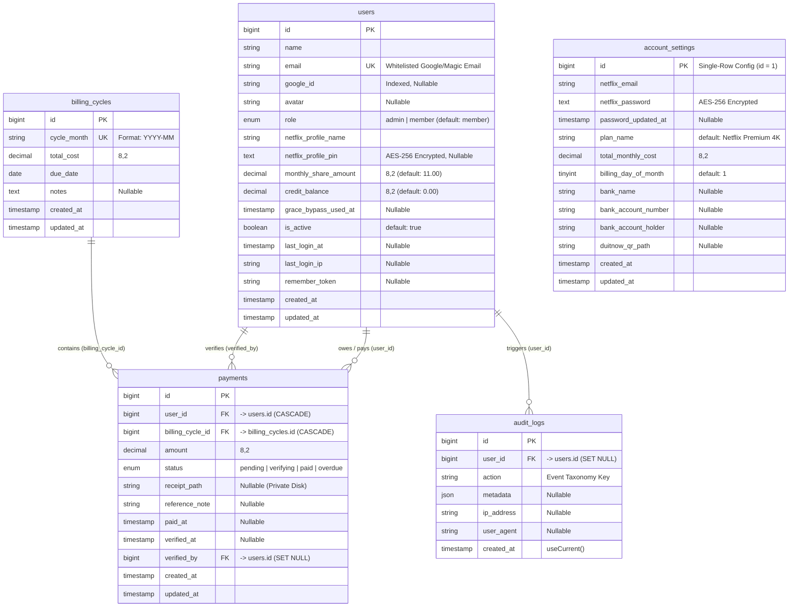

# 5. Backend Schema Documentation (BSD)
**Project Name:** Netflix Household & Split-Billing Portal ("Netflix Household Hub")  
**Document Version:** 1.0  
**Database Engine:** MySQL 8.0+ / MariaDB 10.6+ / SQLite 3 (Laravel 11 Migrations)

---

## 1. Entity-Relationship Diagram (ERD)

---

## 2. Detailed Table Specifications

### 2.1 `users` Table
**Migration:** [`database/migrations/0001_01_01_000000_create_users_table.php`](file:///c:/laragon/www/netflix-automation/database/migrations/0001_01_01_000000_create_users_table.php)  
**Model:** [`App\Models\User`](file:///c:/laragon/www/netflix-automation/app/Models/User.php)

| Column | Type | Nullable | Default | Constraints / Indexes | Notes & Encryption |
| :--- | :--- | :--- | :--- | :--- | :--- |
| `id` | `BIGINT UNSIGNED` | No | Auto-Inc | `PRIMARY KEY` | Internal user identifier |
| `name` | `VARCHAR(255)` | No | — | — | Full display name (e.g., `Alex Tan`) |
| `email` | `VARCHAR(255)` | No | — | `UNIQUE` | Strict login whitelist identifier |
| `google_id` | `VARCHAR(255)` | Yes | `NULL` | `INDEX` | Google OAuth `sub` identifier |
| `avatar` | `VARCHAR(255)` | Yes | `NULL` | — | Google profile picture URL |
| `role` | `ENUM('admin','member')` | No | `'member'` | — | Controls access to `/admin/*` routes |
| `netflix_profile_name` | `VARCHAR(255)` | No | — | — | Associated Netflix profile (e.g., `Alex`) |
| `netflix_profile_pin` | `TEXT` | Yes | `NULL` | — | **Cast: `encrypted`** (AES-256-CBC 4-digit PIN) |
| `monthly_share_amount` | `DECIMAL(8,2)` | No | `11.00` | — | Member's monthly split in RM |
| `credit_balance` | `DECIMAL(8,2)` | No | `0.00` | — | Advance prepaid balance in RM |
| `grace_bypass_used_at` | `TIMESTAMP` | Yes | `NULL` | — | Tracks 24-hour emergency vault bypass |
| `is_active` | `BOOLEAN` | No | `true` | — | Soft-disable member without deleting history |
| `last_login_at` | `TIMESTAMP` | Yes | `NULL` | — | Updated on OAuth, Magic Link, or Demo login |
| `last_login_ip` | `VARCHAR(255)` | Yes | `NULL` | — | Client IP at last authentication |
| `remember_token` | `VARCHAR(100)` | Yes | `NULL` | — | Persistent session token |
| `created_at` / `updated_at` | `TIMESTAMP` | Yes | `NULL` | — | Eloquent timestamps |

---

### 2.2 `account_settings` Table (Singleton Vault & Billing Config)
**Migration:** [`database/migrations/0001_01_01_000003_create_account_settings_table.php`](file:///c:/laragon/www/netflix-automation/database/migrations/0001_01_01_000003_create_account_settings_table.php)  
**Model:** [`App\Models\AccountSetting`](file:///c:/laragon/www/netflix-automation/app/Models/AccountSetting.php)

| Column | Type | Nullable | Default | Constraints | Notes & Encryption |
| :--- | :--- | :--- | :--- | :--- | :--- |
| `id` | `BIGINT UNSIGNED` | No | Auto-Inc | `PRIMARY KEY` | Singleton row (`id = 1`) accessed via `AccountSetting::current()` |
| `netflix_email` | `VARCHAR(255)` | No | — | — | Master Netflix login email |
| `netflix_password` | `TEXT` | No | — | — | **Cast: `encrypted`** (AES-256-CBC master password) |
| `password_updated_at` | `TIMESTAMP` | Yes | `NULL` | — | Auto-updated whenever `netflix_password` rotates |
| `plan_name` | `VARCHAR(255)` | No | `'Netflix Premium 4K'` | — | Displayed in navbar & billing summary |
| `total_monthly_cost` | `DECIMAL(8,2)` | No | — | — | Total subscription fee (e.g., `55.00`) |
| `billing_day_of_month` | `TINYINT` | No | `1` | `1..28` | Day of month billing cycle starts |
| `bank_name` | `VARCHAR(255)` | Yes | `NULL` | — | e.g., `Maybank (Malayan Banking Berhad)` |
| `bank_account_number` | `VARCHAR(255)` | Yes | `NULL` | — | e.g., `1642 8940 3192` |
| `bank_account_holder` | `VARCHAR(255)` | Yes | `NULL` | — | e.g., `Firdaus (Household Admin)` |
| `duitnow_qr_path` | `VARCHAR(255)` | Yes | `NULL` | — | Relative path on `public` disk (`duitnow/*.png`) |
| `created_at` / `updated_at` | `TIMESTAMP` | Yes | `NULL` | — | Eloquent timestamps |

---

### 2.3 `billing_cycles` Table
**Migration:** [`database/migrations/0001_01_01_000004_create_billing_cycles_table.php`](file:///c:/laragon/www/netflix-automation/database/migrations/0001_01_01_000004_create_billing_cycles_table.php)  
**Model:** [`App\Models\BillingCycle`](file:///c:/laragon/www/netflix-automation/app/Models/BillingCycle.php)

| Column | Type | Nullable | Default | Constraints | Notes |
| :--- | :--- | :--- | :--- | :--- | :--- |
| `id` | `BIGINT UNSIGNED` | No | Auto-Inc | `PRIMARY KEY` | Cycle identifier |
| `cycle_month` | `VARCHAR(255)` | No | — | `UNIQUE` | ISO year-month format `YYYY-MM` (e.g., `2026-11`) |
| `total_cost` | `DECIMAL(8,2)` | No | — | — | Snapshot of `total_monthly_cost` for that month |
| `due_date` | `DATE` | No | — | — | Payment due date (`billing_day + 5 days`) |
| `notes` | `TEXT` | Yes | `NULL` | — | Optional cycle description |
| `created_at` / `updated_at` | `TIMESTAMP` | Yes | `NULL` | — | Eloquent timestamps |

---

### 2.4 `payments` Table
**Migration:** [`database/migrations/0001_01_01_000005_create_payments_table.php`](file:///c:/laragon/www/netflix-automation/database/migrations/0001_01_01_000005_create_payments_table.php)  
**Model:** [`App\Models\Payment`](file:///c:/laragon/www/netflix-automation/app/Models/Payment.php)

| Column | Type | Nullable | Default | Constraints | Notes |
| :--- | :--- | :--- | :--- | :--- | :--- |
| `id` | `BIGINT UNSIGNED` | No | Auto-Inc | `PRIMARY KEY` | Payment record identifier |
| `user_id` | `BIGINT UNSIGNED` | No | — | `FK -> users.id (CASCADE)` | Household member |
| `billing_cycle_id` | `BIGINT UNSIGNED` | No | — | `FK -> billing_cycles.id (CASCADE)` | Associated monthly cycle |
| `amount` | `DECIMAL(8,2)` | No | — | — | Snapshot of member's share in RM |
| `status` | `ENUM` | No | `'pending'` | `'pending','verifying','paid','overdue'` | Ledger state |
| `receipt_path` | `VARCHAR(255)` | Yes | `NULL` | — | Private storage path (`receipts/*` or `demo-receipt`) |
| `reference_note` | `VARCHAR(255)` | Yes | `NULL` | — | Bank reference ID or auto-credit note |
| `paid_at` | `TIMESTAMP` | Yes | `NULL` | — | Timestamp when receipt was uploaded or auto-paid |
| `verified_at` | `TIMESTAMP` | Yes | `NULL` | — | Timestamp when Admin approved payment |
| `verified_by` | `BIGINT UNSIGNED` | Yes | `NULL` | `FK -> users.id (SET NULL)` | Admin user who verified the payment |
| `created_at` / `updated_at` | `TIMESTAMP` | Yes | `NULL` | — | Eloquent timestamps |

* **Composite Unique Index:** `UNIQUE (user_id, billing_cycle_id)` prevents duplicate monthly bill rows for the same member in the same cycle.

---

### 2.5 `audit_logs` Table (Immutable Event Log)
**Migration:** [`database/migrations/0001_01_01_000006_create_audit_logs_table.php`](file:///c:/laragon/www/netflix-automation/database/migrations/0001_01_01_000006_create_audit_logs_table.php)  
**Model:** [`App\Models\AuditLog`](file:///c:/laragon/www/netflix-automation/app/Models/AuditLog.php)

| Column | Type | Nullable | Default | Constraints | Notes |
| :--- | :--- | :--- | :--- | :--- | :--- |
| `id` | `BIGINT UNSIGNED` | No | Auto-Inc | `PRIMARY KEY` | Log entry ID |
| `user_id` | `BIGINT UNSIGNED` | Yes | `NULL` | `FK -> users.id (SET NULL)` | Acting user (`NULL` for unauthenticated failed logins or CLI) |
| `action` | `VARCHAR(255)` | No | — | — | Dot-namespaced event key (see Section 4) |
| `metadata` | `JSON` | Yes | `NULL` | — | Structured context payload |
| `ip_address` | `VARCHAR(255)` | Yes | `NULL` | — | Request IP (`request()?->ip()`) |
| `user_agent` | `VARCHAR(255)` | Yes | `NULL` | — | Truncated to 255 chars |
| `created_at` | `TIMESTAMP` | No | `CURRENT_TIMESTAMP` | — | Immutable creation timestamp (`$timestamps = false`) |

---

### 2.6 Framework Infrastructure Tables
* **`sessions`** ([`0001_01_01_000000_create_users_table.php`](file:///c:/laragon/www/netflix-automation/database/migrations/0001_01_01_000000_create_users_table.php#L30-L37)): Stores authenticated user sessions and the `vault_verified_until` step-up timestamp.
* **`cache` & `cache_locks`** ([`0001_01_01_000001_create_cache_table.php`](file:///c:/laragon/www/netflix-automation/database/migrations/0001_01_01_000001_create_cache_table.php)): Stores 5-minute Vault OTP codes (`vault_otp_{user_id}`) and rate-limiter counters (`throttle:*`).
* **`jobs`, `job_batches`, `failed_jobs`** ([`0001_01_01_000002_create_jobs_table.php`](file:///c:/laragon/www/netflix-automation/database/migrations/0001_01_01_000002_create_jobs_table.php)): Ready for asynchronous email queueing if enabled.

---

## 3. Ephemeral State & File Storage Schema

| Storage Layer | Key / Path Pattern | TTL / Visibility | Purpose |
| :--- | :--- | :--- | :--- |
| **Application Cache** | `vault_otp_{user_id}` | `5 minutes` (consumed on first valid use) | Stores the 6-digit numeric OTP for step-up vault verification. |
| **User Session** | `vault_verified_until` | `15 minutes` (cleared on logout/demo-switch) | Timestamp allowing repeat vault reveals within 15m without re-sending OTP emails. |
| **Private Local Disk** | `storage/app/private/receipts/{hash}.{ext}` | Private (`auth` + Owner/Admin policy check) | Stores uploaded member DuitNow transfer receipts (`JPG`, `PNG`, `PDF`). |
| **Public Disk** | `storage/app/public/duitnow/{hash}.{ext}` | Public (via `public/storage` symlink) | Stores the Admin's uploaded DuitNow QR code image. |

---

## 4. Audit Event Taxonomy (`audit_logs.action`)

| Event Key | Trigger Source | Example `metadata` Payload |
| :--- | :--- | :--- |
| `system.seeded` | `DatabaseSeeder@run` | `{"cycle": "2026-11"}` |
| `auth.google_login` | `GoogleAuthController@handleGoogleCallback` | `{"email": "alex@household.local"}` |
| `auth.google_error` | `GoogleAuthController@handleGoogleCallback` | `{"message": "Invalid state..."}` |
| `auth.login_failed` | `GoogleAuthController` | `{"email": "stranger@gmail.com", "reason": "not_whitelisted_or_inactive"}` |
| `auth.magic_link_sent` | `GoogleAuthController@sendMagicLink` | `{"email": "admin@household.local"}` |
| `auth.magic_link_verified` | `GoogleAuthController@verifyMagicLink` | `{"email": "admin@household.local"}` |
| `auth.demo_switch` | `GoogleAuthController@demoSwitch` | `{"switched_to": "chloe@household.local"}` |
| `auth.logout` | `GoogleAuthController@logout` | `null` |
| `imap.code_fetched` | `NetflixImapService@fetchRecentCodes` | `{"mode": "live", "count": 2}` or `{"mode": "demo_fallback"}` |
| `imap.connection_failed` | `NetflixImapService@fetchRecentCodes` | `{"error": "Can't connect to mail..."}` |
| `vault.blocked_overdue` | `VaultController@requestOtp` | `{"payment_id": 25}` |
| `vault.otp_requested` | `VaultController@requestOtp` | `{"email": "alex@household.local"}` |
| `vault.otp_failed` | `VaultController@reveal` | `null` |
| `vault.password_revealed` | `VaultController@reveal` | `{"profile": "Alex", "grace_bypass": false}` |
| `vault.grace_bypass_activated`| `VaultController@activateGraceBypass` | `{"expires_at": "2026-11-02T11:30:00+08:00"}` |
| `payment.receipt_uploaded` | `PaymentController@uploadReceipt` | `{"payment_id": 23, "cycle": "2026-11", "amount": "11.00"}` |
| `admin.payment_verified` | `AdminController@verifyPayment` | `{"payment_id": 23, "member": "Sarah Lim", "amount": "11.00"}` |
| `admin.payment_rejected` | `AdminController@verifyPayment` | `{"payment_id": 23, "member": "Sarah Lim"}` |
| `admin.payment_status_updated`| `AdminController@updatePaymentStatus` | `{"payment_id": 24, "status": "paid"}` |
| `admin.settings_updated` | `AdminController@updateSettings` | `{"password_rotated": true}` |
| `admin.member_updated` | `AdminController@updateMember` | `{"member_id": 2, "email": "alex@household.local"}` |
| `billing.cycle_generated` | `Artisan billing:generate-cycle` | `{"cycle_month": "2026-11", "payments_initialized": 5}` |

